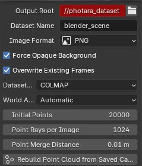
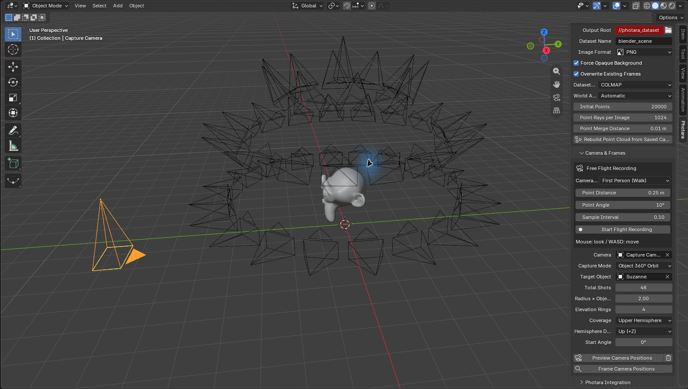

# photara-blender

Render Blender scenes into image datasets with known camera poses and colored surface points for **3D Gaussian Splatting (3DGS)**. Export to COLMAP, Nerfstudio, or Photara's native ASFM format, then optionally hand the dataset to **Photara Studio** or the Photara CLI for training.

## Features

- **Three capture modes:** existing camera animation, multi-level object orbits, and indoor box grids with automatic coverage planning.
- **Free flight recording:** navigate the viewport and turn sampled viewpoints into an editable animated camera.
- **Camera previews:** inspect positions and orientations before rendering.
- **Multiple dataset formats:** COLMAP text models, Nerfstudio `transforms.json`, native `.asfm`, or combined COLMAP + Nerfstudio output.
- **Geometry-based initialization:** colored surface points sampled from rendered images and evaluated scene geometry.
- **Responsive rendering:** progress reporting and cancellation, with completed images and poses retained after an interrupted capture.
- **Optional training handoff:** connect to a running Studio, launch Studio automatically, or start CLI training.
- **Image formats:** PNG, JPEG, WebP, TIFF, and OpenEXR.

## Installation

The add-on declares Blender **3.6 or later** as its minimum version. Screenshots below use a Blender 5.3 development build.

1. Clone or download this repository.
2. From the repository directory, build the installable archive:

   ```powershell
   powershell -File pack.ps1
   ```

3. In Blender, open **Edit → Preferences → Add-ons** and use **Install…** (or **Install from Disk…**, depending on the Blender version).
4. Select `photara_render-1.1.0.zip` and enable **Photara Render & Pose Export**.
5. In the 3D Viewport, press **N** and select the **Photara** tab.

## Quick start

1. Open your scene and select a perspective camera.
2. Set **Output Root**. The default, `//photara_dataset`, resolves next to the saved `.blend` file.
3. Select a **Dataset Format** and **World Axes** under **Output**.
4. Under **Camera & Frames**, select a camera and capture mode:
   - **Camera Animation:** sample an existing camera animation over the scene or custom frame range.
   - **Object 360° Orbit:** select a target and configure image count, radius, levels, coverage, and direction.
   - **Indoor Box Grid:** select room bounds and configure the grid and coverage requirements.
5. Click **Preview Camera Positions** and inspect the plan.
6. Configure **Photara Integration**, or choose **Off** to export only.
7. Click **Render & Export for Photara**.

For static 3DGS training, keep scene geometry and lighting fixed and move only the camera. RGB PNG is a useful starting point; disable Render Region and motion blur.

## Screenshots

These are actual Blender UI captures of a demonstration scene. Camera wireframes show planned viewpoints; they are preview helpers and do not appear in exported renders.

### Output and dataset settings



Choose the output directory, image format, dataset format, world-axis convention, and initial point-cloud sampling settings in **Output**. **Rebuild Point Cloud from Saved Cameras** regenerates initialization points without rendering the images again.

### Object orbit and camera preview



Select **Object 360° Orbit**, assign the target, then adjust the image count, radius, and vertical levels. Click **Preview Camera Positions** to inspect the generated cameras before rendering. This example uses 48 images over four levels.

## Capture modes

### Camera animation

Use the scene camera or explicitly choose a **Camera**. Enable **Use Scene Range**, or supply a start/end frame and step. Poses and intrinsics are evaluated for each sampled frame, including animated focal length and lens shift. Camera and parent scale are removed from exported rotations without changing camera position or direction.

### Object 360° orbit

The chosen camera supplies the lens parameters. Capture uses a temporary perspective camera and evaluates the target center at the current scene frame. The scene camera is restored and the temporary camera removed after completion or cancellation.

- **Upper Hemisphere** is the default, with four levels, suitable for objects resting on a horizontal surface. No viewpoints are placed below the target center in this capture coordinate system.
- Images are distributed among elevation rings by circumference, with alternating azimuth offsets. Each pole has at most one viewpoint, and the total image count is preserved.
- A single level produces one ring: 45° elevation for the upper hemisphere, or the elevation closest to 0° in the selected range otherwise. Full-sphere sampling needs at least three levels to distribute extra images beyond the two poles.
- **Hemisphere Direction** selects a world direction: Up (+Z), Down (-Z), Left (-X), Right (+X), Front (-Y), or Back (+Y).
- With **Custom Empty**, the Empty's world rotation defines the capture frame: local +Z points toward the hemisphere top, and local X/Y define azimuth. Its position and scale do not affect the target center or capture radius. Parented Empties are evaluated at the current frame.
- Custom elevations are relative to the capture frame's equator; **Start Angle** rotates around its local Z axis. Full-sphere layering follows the same orientation.

Regenerate the preview after changing settings. Preview, rendering, and pose-only export share the same pose-generation logic. Direction and rotation metadata are exported. Orbit capture does not automatically detect support surfaces or avoid obstacles. Existing `.blend` files retain their saved mode and level settings.

### Free flight recording

1. Under **Camera & Frames → Free Flight Recording**, set **Point Distance**, **Point Angle**, and **Sample Interval** in seconds. A new viewpoint is recorded when either the distance or orientation threshold is reached.
2. Start from a perspective view and select **Camera Control**:
   - **First Person (Walk):** horizontal movement at a fixed height, with Q/E for vertical movement.
   - **Free Flight:** move along the viewing direction.
   - **Manual View Navigation:** use Blender's own viewport navigation.
3. In the first two modes, use the mouse to look, WASD to move, Q/E to move vertically, and Shift to accelerate. **Enter** saves; **Esc** discards and restores the view. Speed and mouse sensitivity follow **Preferences → Navigation → Walk**.
4. In manual mode, finish Blender navigation first, then click **Stop & Generate**. **Cancel** discards the recording.
5. The add-on creates a separate **Photara Recorded Flight** camera, with one integer frame per viewpoint and quaternion orientation keys. It selects Camera Animation and sets the capture range automatically. Click **Render & Export for Photara** to capture those views.

The initial and final positions are retained; stationary views are not repeatedly sampled. Recording stops and generates the camera at 10,000 points. Starting from camera view uses an independent navigation camera with the existing composition and lens settings. The original camera animation is preserved.

Recorded animation is saved with the `.blend` file and can be edited in the timeline or selected again later. Recording stores viewpoints rather than travel speed or dwell time. Lens parameters are fixed at recording start. Orthographic views are unsupported; switching scenes or closing the viewport cancels recording. **Preview Camera Positions** rebuilds the preview from the current animation range; the trash button clears preview helpers while keeping the recorded camera and animation.

### Indoor box grid

1. Select a perspective **Camera** and **Room Bounds**: a box-shaped mesh or Cube Empty, including rotated and scaled bounds. Enable **Bounds Is Helper** for a helper box so it is temporarily hidden during capture; disable it when using the actual room shell. Keep walls, furniture, and interior details render-visible.
2. Enable **Automatic Coverage**. Defaults use a 3 × 3 × 3 grid, a 24 mm capture lens, and 35% angular overlap. Capture includes upward and downward views; the original camera lens is preserved. For a single height layer, camera height is measured from the box bottom.
3. Click **Preview Camera Positions**. The planner uses the current resolution, pixel aspect, and capture intrinsics to test visibility, then adds positions or directions for poorly covered surfaces. Planning remains cancellable.
4. Inspect coverage markers: **red** means unseen; **orange** means too few independent observations. In Solid shading, use **Material** or **Object** as Color Type to see the colors. Rebuild the preview after scene or setting changes.
5. Adjust the XYZ grid, **Coverage Samples**, **Image Budget**, bounds, and geometry clearance. By default, each sample needs three independent camera positions, at least 5° of viewing-direction separation, and position spacing of at least **Geometry Clearance**. Rotating in place does not increase the independent-position count.
6. **Require Coverage Target** blocks rendering when sampled coverage is incomplete. An insufficient image budget does not silently truncate the base grid.
7. Render and export. The add-on replans the current scene, captures base and additional views, and writes a coverage report. The stop control ends the sequence after the current frame; Esc can abort the current render. Interrupted captures retain completed images and poses and do not start training.

`capture_coverage.json` records sample counts, unseen/insufficient samples, image budget, extra views, camera positions, and observation counts. It distinguishes planned coverage from coverage of completed images. **Coverage Samples** controls analysis density, not point-cloud density. Surface sampling is weighted by triangle area; coverage statistics are not a per-pixel guarantee.

## Dataset formats and world axes

| Dataset Format | Cameras and poses | Initial points |
|---|---|---|
| **COLMAP** (default) | `sparse/0/cameras.txt` and `images.txt`; OpenCV world-to-camera poses | `points3D.txt` and full colored `initial_points.ply` |
| **Photara Studio Native (.asfm)** | `scene.asfm`; native world-to-camera rotation and camera center | Valid multi-view sparse tracks in ASFM; full surface cloud in PLY |
| **Blender / Nerfstudio** | `transforms.json`; OpenGL camera-to-world matrices and per-frame intrinsics | Full colored PLY referenced by `ply_file_path` |
| **COLMAP + Nerfstudio** | Both general-purpose formats | The same surface cloud in both formats |

**World Axes** controls scene coordinates separately from the camera's OpenGL/OpenCV convention. **Automatic** uses Photara's **-Y up** convention for COLMAP, native Photara, and combined output; Nerfstudio retains Blender's **+Z up** convention. You can explicitly select either convention.

The Photara conversion is the right-handed rotation `(x, y, z) → (x, -z, y)`, applied consistently to point positions, camera positions, and orientations. It preserves image projections without mirroring an axis. Sampling and capture records retain Blender coordinates; rebuilding points applies the convention stored in the manifest once. Clear any old corrective Studio Transform when replacing manually reoriented Z-up data with newly exported -Y-up data.

Native ASFM uses the non-compact v4 binary layout implemented by `photara/src/sfm/asfm.cpp`, including length prefixes, FNV-1a checksums, and absolute image paths. Tracks are built by reprojection and occlusion checks and require at least two valid image observations. Single-view surface points remain in the full PLY; the manifest reports both counts. Open or drag `scene.asfm` into Studio directly.

**Native ASFM does not currently support automatic training handoff:** the Studio `project.set_dataset` and CLI `--splat-dataset` readers used by this integration do not accept ASFM. Choose COLMAP or Nerfstudio for automatic import and training. Handoff passes the selected model directory or JSON explicitly to avoid accidentally importing stale files from another format.

Every format preserves full capture records in `photara_dataset.json`; point-cloud rebuilding does not require `transforms.json`. Switching formats does not delete previous output files. The current manifest identifies the selected format. Legacy COLMAP/transforms checkbox settings are mapped to the new format selector until an explicit selection is made.

## Surface point-cloud initialization

All capture modes share the same initialization pipeline: sample pixel centers in saved images, cast rays using each frame's intrinsics and pose, retain the first visible hit in evaluated geometry, and read its rendered pixel color. Render-hidden objects and preview helpers are excluded. Points lie on actual geometry rather than being randomly placed around the camera trajectory.

Samples in the same voxel are merged and their colors averaged while retaining real hit positions. Deterministic reservoir sampling limits the cloud across the full sequence. Single-view hits are valid because geometry is known; general surface initialization does not require SfM triangulation or export feature tracks. Native ASFM tracks have the separate multi-view requirement described above.

| Output setting | Default | Purpose |
|---|---|---|
| Initial Points | 20,000 | Maximum retained surface points |
| Point Rays per Image | 1,024 | Pixel-ray samples per saved image |
| Point Merge Distance | 0.01 scene units | World-space voxel merge distance |

Missing pixels, background, and failed geometry hits do not produce placeholder points. `initial_points_report.json` records ray counts, hits, retained points, and pixel-read failures. COLMAP and PLY use the same colored points; Nerfstudio output also stores the PLY path, scene frames, and clipping ranges. PNG/JPEG colors follow saved pixels; linear HDR EXR colors are converted to 8-bit sRGB with highlight clipping and do not reproduce AgX/Filmic display rendering.

To rebuild an existing dataset, open the original capture scene, set **Output Root**, and click **Rebuild Point Cloud from Saved Cameras**. Animation mode evaluates geometry at each recorded frame; orbit capture uses the source scene frame. Moving geometry may produce overlapping time samples in a static 3DGS model; final appearance is learned from rendered images.

Coverage analysis treats meshes as opaque and does not simulate glass, mirrors, or volume materials. Use consistent viewport/render modifier levels. Render-visible meshes hidden or excluded from the viewport block analysis until viewport visibility is enabled. Do not edit the scene during planning or capture. Closed room interiors allow viewpoints, while enclosed standalone furniture interiors are excluded. Self-intersecting or non-manifold geometry may require repair or adjusted bounds. Inaccessible surfaces remain uncovered; narrow or occluded regions may need denser sampling and grids. Successful sampled coverage does not guarantee reconstruction quality, which also depends on texture, lighting, resolution, and training parameters.

## Photara integration

| After Render mode | Behavior |
|---|---|
| **AUTO** | Discover a running Studio, load the dataset, and optionally start training; otherwise launch `photara_studio.exe --enable-agent-control` and connect |
| **Connect Studio Only** | Connect only to an already running Studio |
| **CLI Training** | Run `photara.exe --splat-dataset <dataset> --output <result.sog>` without a GUI |
| **Off** | Export only |

Executable paths can be left empty for automatic detection. Studio must be started with `--enable-agent-control`. AUTO supplies this flag when launching Studio; if an existing instance lacks the interface, the add-on reports it instead of blindly launching a second instance.

Discovery reads `%APPDATA%\Photara\control\*.json`. The add-on uses authenticated `POST /v1/rpc` calls to `studio.project.set_dataset` and, when automatic training is enabled, `studio.job.start` with `stage: "train"`. Older Studio versions without `set_dataset` fall back to the image directory and prompt for an upgrade.

Recent compatible Photara builds can train directly from Nerfstudio output:

```powershell
photara.exe --splat-dataset "D:/data/scene01/transforms.json" --output "D:/data/scene01/result.sog"
```

Studio can open the JSON through its external-dataset picker or receive it through AUTO / STUDIO handoff. Older builds may lack the Nerfstudio importer. Without a point cloud, compatible Photara builds use deterministic random initialization; an initial PLY can also be specified in Photara.

## Output layout

Files depend on the selected dataset format and capture mode:

```text
photara_dataset/
├── images/
│   ├── frame_00000000.png
│   └── ...
├── sparse/0/                  # COLMAP text model
│   ├── cameras.txt            # CAMERA_ID PINHOLE W H fx fy cx cy
│   ├── images.txt             # IMAGE_ID QW QX QY QZ TX TY TZ CAMERA_ID NAME
│   └── points3D.txt           # Colored visible-surface points
├── scene.asfm                 # Native Photara model
├── transforms.json            # Nerfstudio/Blender poses and intrinsics
├── initial_points.ply         # Full colored surface initialization
├── initial_points_report.json # Sampling statistics and read failures
├── capture_coverage.json      # Indoor coverage report
└── photara_dataset.json       # Dataset manifest and capture records
```

## Camera conventions

Blender/OpenGL cameras use +X right, +Y up, and look along -Z. COLMAP/OpenCV cameras use +X right, +Y down, and look along +Z. Before any selected world-axis conversion:

```text
R_w2c = diag(1, -1, -1) @ R_blender_c2w^T
t_w2c = -R_w2c @ C
```

Intrinsics are expressed in pixels:

```text
aspect = pixel_aspect_y / pixel_aspect_x
view_factor = width (HORIZONTAL) or aspect * height (VERTICAL)
fx = focal_mm / sensor_mm * view_factor
fy = fx / aspect
cx = width/2 - shift_x * view_factor
cy = height/2 + shift_y * view_factor / aspect
```

Nerfstudio `transform_matrix` stores the camera-to-world position and rotation without camera scale, using OpenGL camera axes and the selected world-axis convention. COLMAP creates separate cameras for distinct intrinsics; Nerfstudio stores per-frame intrinsics. Sensor fit, pixel aspect, and lens shift are included.

## Headless rendering

With the add-on enabled in Blender:

```powershell
blender -b scene.blend --python-expr "import photara_render.api as p; p.render_and_export(output_root='D:/data/scene01', camera_name='Camera', frame_start=1, frame_end=120, handover_mode='CLI')"
```

Background mode uses blocking execution. Explicit script frame ranges disable **Use Scene Range**.

## Compatibility notes

- Perspective cameras are required; orthographic and panoramic cameras are rejected.
- For an opaque training background, the add-on temporarily disables `film_transparent` by default and restores it afterward. This behavior can be disabled under Output.
- Photara integration depends on a compatible Studio/CLI build; exporting a dataset does not require Studio to be running.

Relevant implementation locations in the companion Photara Studio source tree:

| Capability | Source location |
|---|---|
| External datasets and imported cameras that skip SfM | `photara/src/splat/dataset*.cpp` |
| Agent Control discovery, bearer authentication, and RPC | `apps/editor/control/` |
| `studio.project.set_dataset` command | `apps/editor/control/control_commands.cpp` |
| CLI dataset training | `photara/src/tools/reconstruct.cpp` |
| Nerfstudio export conventions | `photara/src/sfm/export_nerfstudio.cpp` |

## Tests

```powershell
python tests/test_camera_utils.py
python -m unittest discover -s tests -v
blender -b --factory-startup --python-exit-code 1 --python tests/blender_indoor_capture.py
```

## License

Licensed under the [Apache License 2.0](LICENSE).
